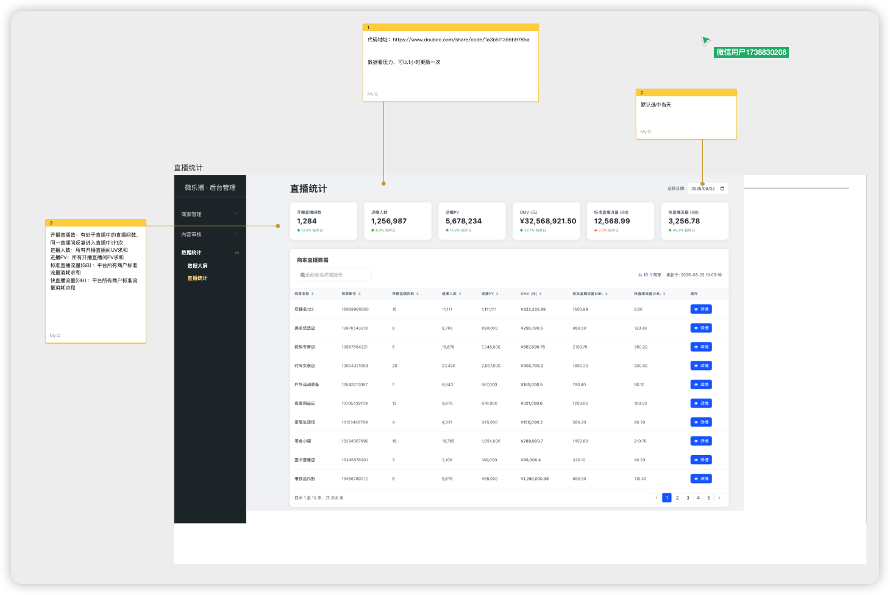
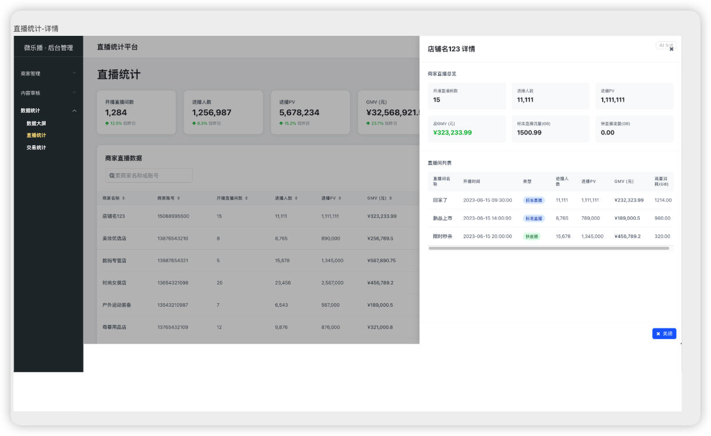

# 直播统计——前端技术方案

## 基础信息
### 产品文档地址
https://modao.cc/proto/NnqjsyD1t0ikbwWulbz1ff/sharing?view_mode=read_only&screen=rbpUuUdJU9UKFg2cf
### 产品截图

### 功能需求
基于上方页面截图，直播统计模块的核心功能需求包括：

1. 直播数据总览
   - 展示关键指标卡片，包含：
     - 开播场次
     - 累计观看人数
     - 累计观看次数
     - 累计成交金额
     - 累计订单数
     - 累计客单价
   - 每个指标支持同比/环比趋势展示（如绿色向上箭头及百分比）

2. 直播明细数据表
   - 支持按场次/主播/时间等维度展示明细数据
   - 表格字段包括：
     - 直播场次名称
     - 场次编号
     - 开播时间
     - 累计观看人数
     - 累计观看次数
     - 累计成交金额
     - 累计订单数
     - 客单价
     - 操作（如“详情”按钮）

3. 数据筛选与查询
   - 支持按时间范围筛选（如日期选择器）
   - 支持关键字搜索（如场次名称、编号等）

4. 分页与导出
   - 明细表支持分页浏览
   - 支持导出当前筛选结果（如导出为Excel）

5. 其他辅助功能
   - 数据刷新
   - 指标说明/帮助提示
   - 详情跳转（点击“详情”按钮可查看单场直播详细数据）

> 以上功能点为前端实现直播统计页面的主要需求，需结合后端接口设计与数据结构进一步细化。
##  设计方案

### 目录结构
// 代码结构差分示例（假设在 src/modules/live-statistics/ 下新建模块）

+ src/modules/live-statistics/
|-- index.vue                // 直播统计主页面
|-- components/
|   |-- OverviewCards.vue    // 直播数据总览指标卡片
|   |-- TrendArrow.vue       // 同比/环比趋势箭头组件
|   |-- DetailTable.vue      // 直播明细数据表
|   |-- FilterBar.vue        // 筛选与查询组件（时间、关键字等）
|   |-- ExportButton.vue     // 导出按钮
|   |-- RefreshButton.vue    // 数据刷新按钮
|   |-- IndicatorHelp.vue    // 指标说明/帮助提示
|-- detail/
|   |-- index.vue            // 单场直播详情页
|-- api.ts                   // 直播统计相关接口
|-- types.ts                 // 类型定义

### 代码实现
// 直播统计主页面（src/modules/live-statistics/index.vue）
<template>
  

    <h1>直播统计</h1>
  

</template>

## 主页面设计
- 头部导航
  - 左边标题 
  - 右边时间筛选按钮 —— 日期选择器
    - 默认选中当天
- 第二排 数据总览 —— 数据卡片
  - 开播直播间数 —— 数字
  - 进播人数 —— 数字
  - 进播PV ——— 数字
  - GMV —— 数字（保留两位小数）
  - 标准直播流量（GB） —— 数字（保留两位小数）
  - 快直播流量（GB） —— 数字（保留两位小数）
- 第三排 商家直播数据
  - 第一排 标题 商家直播数据 —— 标题
  - 第二排 筛选
    - 左边 搜索商家名称或账号
    - 右边 展示总数 更新时间
  - 第三排 表格
    - 第一列 商家名称 —— 字符串
    - 第二列 商家账号 —— 数字
    - 开直播间数 —— 数字 —— 标记成绿色
    - 进播人数 —— 数字
    - 进播PV ——— 数字
    - GMV（元）—— 字符串（金额格式化）
    - 标准直播流量（GB） —— 字符串（GB格式化）
    - 快直播流量（GB） —— 字符串（GB格式化）
    - 操作 —— 按钮
      - 详情（按钮） —— 打开抽屉弹窗，传入详情id 内部是详情页面（见详情页设计）

## 详情页设计
- 头部展示 标题 xxx（店铺名称） 详情
- 第二排 商家直播总览
  - 第一行 标题 商家直播总览 —— 标题
  - 第二行 数据卡片
    - 开播直播间数 —— 数字
    - 进播人数 —— 数字
    - 进播PV ——— 数字
    - 总GMV（元）—— 数字（保留两位小数）
      - 标记成绿色
    - 标准直播流量（GB）—— 数字（保留两位小数）
    - 快直播流量（GB）—— 数字（保留两位小数）
  - 第三排 表格 标题 直播间列表
    - 第一列 直播间名称
    - 第二列 开播时间
    - 第三列 类型
    - 第四列 进播人数
    - 第五列 进播PV
    - 第六列 GMV（元）
    - 流量消耗（GB）

